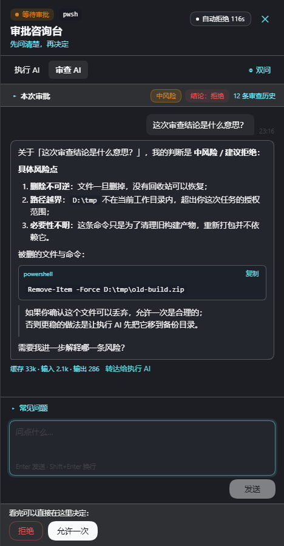

# dsh-approval-consult

[](https://github.com/0tests/dsh-approval-consult/actions/workflows/ci.yml)
[](LICENSE)
[](https://www.npmjs.com/package/dsh-approval-consult)

> **English** · [中文主 README](README.md)

An approval-consultation panel plugin for [DeepSeek Harness](https://github.com/deepseek-ai/deepseek-harness) (DSH Web).
While a tool call is waiting for your approval, it lets you **ask the executing AI and the
auto-review AI independently** — two isolated channels, free-form Q&A plus common preset
questions, without leaving the approval card.



## Why

Approval cards usually give you a one-line reason and a 60s window. The AI that proposed the call
and the AI that reviewed it have different views of the risk, but you can only read their stderr-like
notes or reject blindly. This plugin adds a consultation panel on top of the approval flow:

- **Ask the executor AI** — reuses the exact captured prefix of your main conversation request, so
  provider prompt cache mostly hits; answers include full task context.
- **Ask the reviewer AI** — reuses the auto-review request prefix (`REVIEW_POLICY` + four material
  sections) when available; otherwise it rebuilds the same materials from the session log and runs a
  one-shot advisory classification with the official policy text. Reviewer conversations never enter
  the main chat.
- **双问 (ask both)** — send one question to both sides, each answer stays in its own tab.
- Executor Q&A is written back into the session as a labeled `approval-consult` context record
  (visible in the history panel; official Chat hides plain context rows).
- Decide “Allow once / Reject” right inside the panel — same action as the official card.

## Features

- Floating pill during approval (desktop drawer / mobile bottom sheet), keyboard accessible,
  light/dark/custom-wallpaper theme safe.
- Streaming Markdown answers, token/cache usage, stop & retry, follow-up questions, relay reviewer
  answers to the executor (pending approvals only).
- **Graceful degradation**: no auto-review plugin → executor-only UI; no `dsh-approval-timeout` plugin
  → no countdown probing, no countdown UI at all. Both are auto-detected; can be forced with
  `reviewerMode` / `timeoutAutoPause`.
- **Custom common questions**: edit inside the panel (add/delete/reorder/reset), persisted to
  `~/.dsh-approval-consult/presets.json` (or the profile data dir when DSH runs with `--profile`;
  override with the `dataDir` config or `$DSH_APPROVAL_CONSULT_DATA`).
- Read-only consultation history chip at the end of the chat turn (turnTail slot).
- **Copy review opinion**: one click copies the review verdict/risk/tool/reason as plain text you can
  paste into the chat for the executing AI. Purely local — no extra request; hidden when no auto-review
  plugin is installed.
- Survives plugin hot-reload: pending/thread state is kept in-process; approvals lost from memory can
  be rebuilt from the session log.

## Install

Requires DSH Web `0.2.1-rc.2` (tested) and Node `>=20`.

Current version **v1.1.2**, published to npm ([`dsh-approval-consult`](https://www.npmjs.com/package/dsh-approval-consult)) and as a [GitHub release](https://github.com/0tests/dsh-approval-consult/releases/tag/v1.1.2).

```bash
npm install dsh-approval-consult
```

Or install the release tarball:

1. Download `dsh-approval-consult-1.1.2.tgz` from
   [Releases](https://github.com/0tests/dsh-approval-consult/releases/latest).
2. Open DSH Web → **Plugins** → **Add plugin** → **Install third-party plugin** and point it at the
   tarball's absolute path (or the download URL directly).
3. Enable it and restart `dsh web` once.

Alternatively clone the repository and install its directory, or use `plugin_manager.install_bundle`.

> `devWatch` and `devTools` default to **false** in this package. Local development can override them
> in the profile `cordis.patch.yml` (`- id: approval-consult` → `devWatch: true, devTools: true`).

## Configuration

`cordis.patch.yml` → `approval-consult.config`:

| key | default | description |
| --- | --- | --- |
| `devWatch` | `false` | hot-reload host implementation when files change |
| `devTools` | `false` | enable `/debug/*` diagnostic routes (never in production) |
| `maxQuestionChars` | `2000` | max question length |
| `maxConcurrentJobs` | `3` | concurrent side-call answers per approval |
| `executorMaxTokens` / `reviewerMaxTokens` | `4000` / `2400` | answer budgets (clamped to ≥3000/≥1800) |
| `threadTtlMs` | `7200000` | in-memory thread retention |
| `timeoutAutoPause` | `on-send` | pause `dsh-approval-timeout` countdown: `on-send` / `on-open` / `off` |
| `reviewerMode` | `auto` | reviewer capability: `auto` (detect plugin) / `on` / `off` |
| `presets` | builtin | deployment default common questions (user edits in panel take precedence) |

## Compatibility

See [docs/COMPATIBILITY.md](docs/COMPATIBILITY.md) for the full matrix (DSH surface, optional plugins,
browser fallbacks, data & privacy). Highlights:

- **Web and DSH Desktop**: the desktop app runs the same DSH web application (same `ctx.webServer`, same
  frontend, same `window.__ModuleLoader__` client protocol, same slots) behind the `dsh-app://app` custom
  protocol, which proxies everything else to the local host server. No code change is needed — the plugin
  just has to be installed into the `desktop` profile, which is the only profile the desktop app boots.
  See [docs/DESKTOP.md](docs/DESKTOP.md).
- Optional deps: `@deepseek-ai/dsh-experimental-auto-review` (reviewer channel),
  `dsh-approval-timeout` (countdown integration). Missing either degrades cleanly.
- `shell.overlay` and `conversation.chat.turnTail` slots are required/optional respectively; missing
  slots only log a warning, never break the page.
- No official approval card DOM takeover, no global keyboard interception, no reads of other plugins' DOM.

## Development

```bash
npm run check   # syntax
npm test        # host unit tests + zh/en locale parity
```

The plugin has no build step: `lib/` is shipped as-is (ESM host + browser client bundle).
Design docs live in `docs/` (contract, verification, dogfooding, compatibility, publishing checklist).

## License

MIT. Third-party attributions in [NOTICE.md](NOTICE.md). The optional `review-policy.txt` is extracted
from the MIT-licensed DSH auto-review package and is automatically refreshed from live review requests.

## Status

1.1.0 adds in-panel image attachments (compatible with the shared DSH attachment store), a one-click
"copy review opinion" action, interrupted-stream recovery, and a retry for side calls that only emit tool
calls. Still planned: advisory auto-assessment options and a decision note attached to allow/deny.

See [CHANGELOG.md](CHANGELOG.md) and [docs/PUBLISHING.md](docs/PUBLISHING.md).
