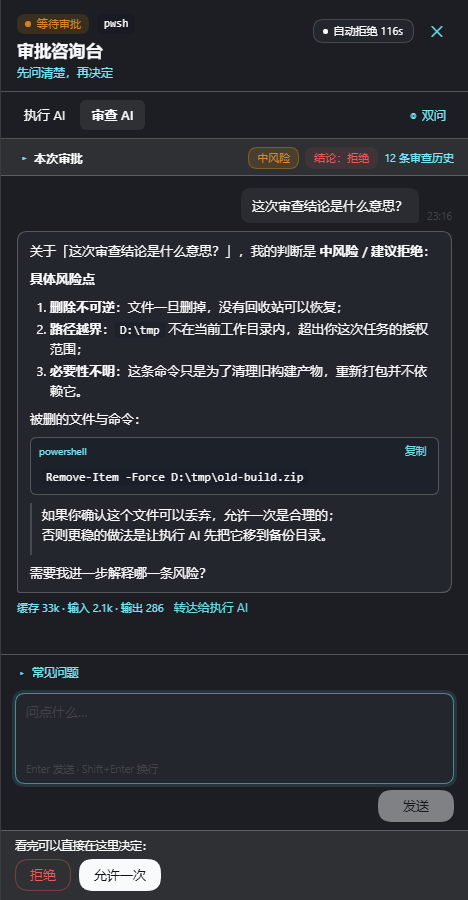
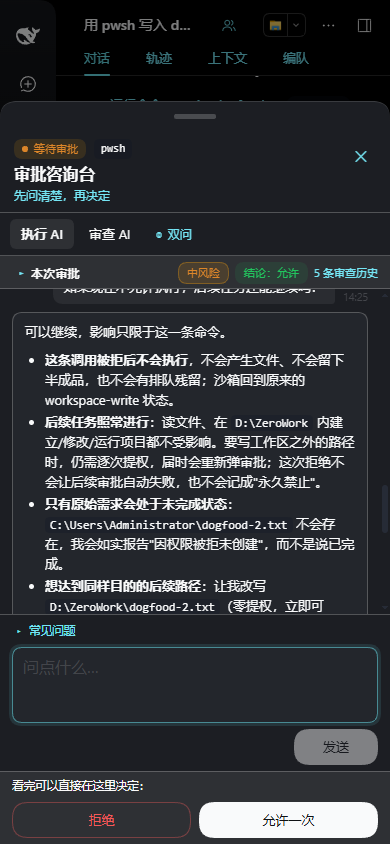
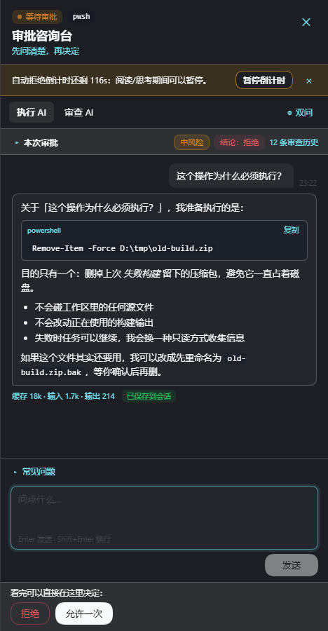
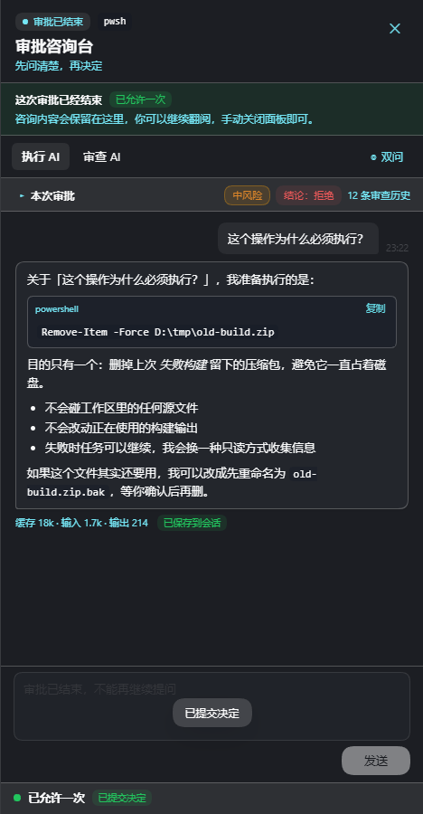
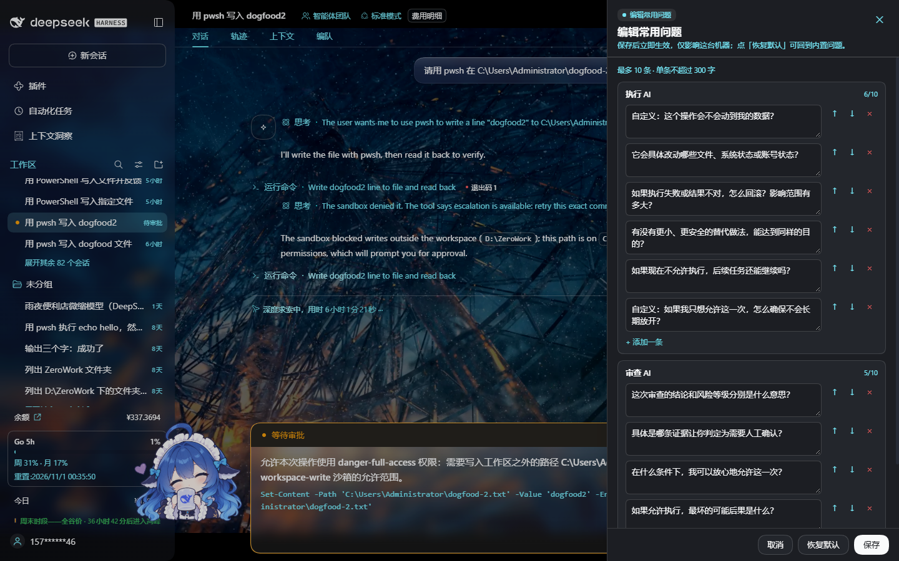
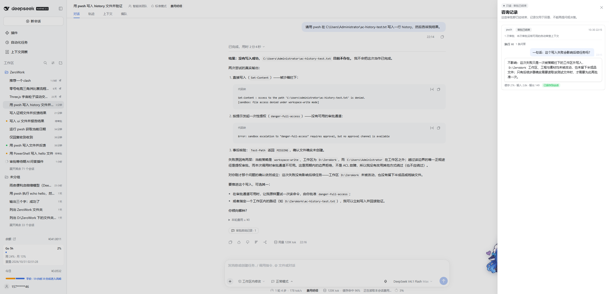
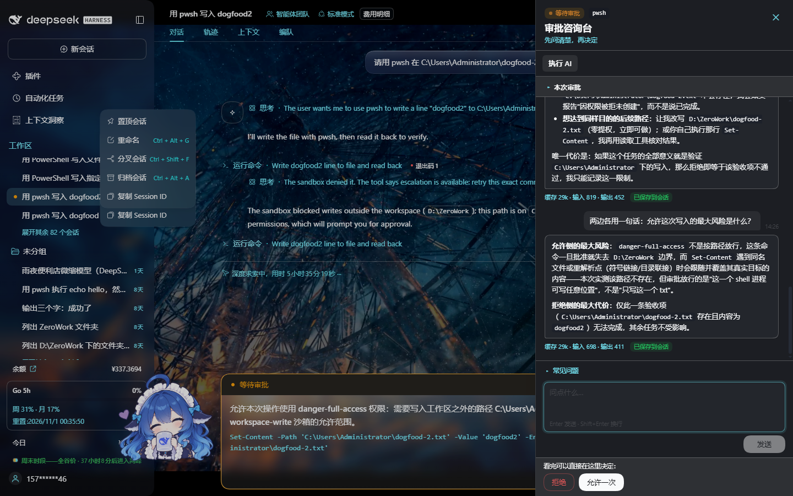

# 审批咨询台 · dsh-approval-consult

[](https://github.com/0tests/dsh-approval-consult/actions/workflows/ci.yml)
[](LICENSE)
[](https://www.npmjs.com/package/dsh-approval-consult)

> [English](README.en.md) · 中文
>
> 在 DSH（DeepSeek Harness）里，当某个工具调用正在等待你审批时，让你可以**分别**问「执行任务的 AI」和「自动审查 AI」，把风险问清楚再决定；有用的问答会自动留在会话里，不会“选完就忘”。

这是一个本地 DSH Web 插件（宿主 Cordis 插件 + 浏览器端 `dsh.client` 模块），无构建步骤、无第三方运行时依赖。

---

## 为什么需要它

Auto 审查（`@deepseek-ai/dsh-experimental-auto-review`）会在工具执行前做一次风险审查。审查拒绝后，用户会看到一张审批卡片：

- **拒绝**：AI 会立刻收手，但它不知道你为什么拒绝；
- **允许一次**：AI 继续跑，但它不知道审查 AI 提醒了什么；
- 用户想弄明白审查意见，只能先拒绝、再把理由复制给 AI —— 又慢又容易丢上下文。

审批咨询台把这一步搬到审批卡片旁边：

- 悬浮胶囊 → 面板（桌面右侧抽屉 / 手机底部弹层）；
- 「执行 AI」「审查 AI」两条独立通道，可自由选择问谁，也可以「双问」；**没装官方自动审查插件时自动降级为只问执行 AI**（不显示审查 AI 相关入口与文案，`reviewerMode` 可强制开关）；
- 常用问题一键发送，回答流式输出；**常用问题可在面板内直接编辑**（新增/删除/排序/恢复默认），
  持久化到 `~/.dsh-approval-consult/presets.json`（DSH 以 `--profile` 启动时落在该 profile 数据目录；
  可用 `dataDir` 配置或环境变量 `DSH_APPROVAL_CONSULT_DATA` 覆盖）；
- 执行 AI 的问答自动注入会话（AI 下一步就能看到；官方 Chat 默认隐藏普通 context 行，所以用户回看入口是面板线程与「咨询记录」历史面板）；
- 审查 AI 的回答默认不进主对话，点「转达给执行 AI」才注入（仅审批等待期间可用；结束后记录只读，不能转达）；
- 看完直接在面板里「允许一次 / 拒绝」，和官方审批卡片是同一个动作；
- 面板里能看到执行 AI / 审查 AI 的实时回答、缓存命中与「已保存到会话」标记；
- 与自动拒绝倒计时（`dsh-approval-timeout`）可选集成：默认**打开面板不打扰倒计时**，只有你真正开始提问时才暂停（可配置 `on-open` / `off`；该插件的取消是全局的，自动暂停遇到其它待审批项会拒绝并提示）。**没装该插件时完全不探测、不显示任何倒计时内容**。

---

## 安装

> 当前版本 **v1.1.4**，已发布到 npm（[`dsh-approval-consult`](https://www.npmjs.com/package/dsh-approval-consult)）和 [GitHub Release](https://github.com/0tests/dsh-approval-consult/releases/tag/v1.1.4)。
> `npm install dsh-approval-consult`，或让 Agent 用 `plugin_manager` 安装这个包名；下面也保留了 tarball / 本地目录两种方式。

### 方式 A：npm

1. `npm install dsh-approval-consult`（或让 Agent 用 `plugin_manager` 的 `install_bundle` 安装 npm 包名）；
2. 在 DSH Web 的「插件」里启用；
3. 重启一次 `dsh web` 更稳。

### 方式 B：从 Release 安装（tarball）

1. 在 [Releases](https://github.com/0tests/dsh-approval-consult/releases/latest) 下载
   `dsh-approval-consult-1.1.4.tgz`；
2. 打开 DSH Web → 左侧「插件」→「添加插件」→「安装第三方插件」，填这个 tarball 的绝对路径，
   或直接填下载链接
   `https://github.com/0tests/dsh-approval-consult/releases/download/v1.1.4/dsh-approval-consult-1.1.4.tgz`；
3. 安装完成后点「立即启用」，重启一次 `dsh web` 更稳。

### 方式 C：本地目录（源码 / 开发）

1. `git clone https://github.com/0tests/dsh-approval-consult`；
2. 打开 DSH Web →「插件」→「添加插件」→「安装第三方插件」，输入该目录的绝对路径；
3. 安装完成后点「立即启用」。

### 方式 D：CLI / 会话内

让 Agent 用 `plugin_manager` 的 `install_bundle` 安装该 tarball / 目录 / npm 包（需要审批权限）。

> **桌面端（DSH Desktop）**：桌面端内部是同一套 Web 应用，插件不用改代码，但要装进桌面端使用的
> `desktop` profile（它只启动这一个 profile）。步骤与验收清单见 [`docs/DESKTOP.md`](docs/DESKTOP.md)。

> 发布默认 `devWatch: false`、`devTools: false`（安全默认）。本地开发时可在 profile 的
> `cordis.patch.yml` 覆盖：`- id: approval-consult` → `devWatch: true` / `devTools: true`。
> 以本地目录（link）安装且打开 devWatch 时，`lib/impl.js` 改动会自动热重载；`lib/client.js` 的改动由
> DSH 的 client-hmr 自动热更到已打开的页面。修改 `package.json` / `cordis.patch.yml` 后建议重启一次 DSH。

---

## 使用

1. 触发一个需要审批的工具调用（例如 Auto 审查拒绝一次中风险操作，或 sandbox 需要临时提权）。
2. 审批卡片出现时，右上角（手机在右上角偏下）会出现「⚠ 审批有疑问？」胶囊。
3. 点胶囊打开面板：
   - 顶部：状态、工具名；若装有 `dsh-approval-timeout` 会显示倒计时与暂停入口（没装则完全不做这件事）；
   - 上下文卡片：风险等级/审查结论/理由、审查依据条数、工具参数（可展开）、执行 AI 上一步说明；
   - Tab：执行 AI / 审查 AI（未装自动审查插件时只有执行 AI）/ 双问（同上）；
   - 预设问题 chips：点一下即发送；点右侧「编辑」可新增/删除/排序/恢复默认，保存后立即生效；
   - 输入区：自由提问，支持追问；回答流式显示，并标注缓存命中/输入/输出 token；
   - 底部：拒绝 / 允许一次。
4. 读完再决定。执行 AI 的问答会以「审批咨询记录」注入会话；审查 AI 的回答可点「转达给执行 AI」（审批结束前）。
5. 审批结束后面板保留全部问答（banner 提示已结束），可继续阅读或关闭。

### 审查 AI 的两种模式

- **官方审查已捕获**：直接显示当时那次审查的 `risk/decision/reason`、审查依据条数，并可追问。上下文 = 官方那次审查请求的**原始前缀**（`REVIEW_POLICY` + 四段材料 + 它的结论），不塞主对话。
- **没有捕获到官方审查**（例如 sandbox 提权这类非 auto-review 的审批）：面板显示「审查材料已就绪」和「让审查 AI 重新评估」按钮。点击后按官方 `REVIEW_POLICY` 与同样的四段材料规则（从会话日志重建 `ENVIRONMENT / PROJECT_INSTRUCTIONS / FILTERED_HISTORY / PENDING_ACTION`）跑一次分类，给出 advisory 的风险结论，然后可继续追问。**这只是帮你判断的参考意见，不是官方审批结论。**

### 没有装自动审查插件时

宿主启动时通过 cordis 插件注册表检测 `experimental-auto-review` 是否在运行（`reviewerMode: 'auto'` 默认）：

- **未安装/未启用**：`/context.features.reviewerAvailable = false`，客户端隐藏「审查 AI」tab、双问、审查侧文案与「重新评估」入口，只保留「执行 AI」问答；宿主 `/ask`、`/review` 对 reviewer 也直接返回 `409 reviewer-unavailable`（防止旧页面/脚本绕过）。
- **已安装**：恢复双通道；也可用 `reviewerMode: 'on' / 'off'` 强制开关。

---

## 配置

在 profile 的 `cordis.patch.yml` 中覆盖本插件的 `config`（或在 bundle 的 `cordis.patch.yml` 中修改后重启）：

| 键 | 默认 | 说明 |
| --- | --- | --- |
| `devWatch` | `false` | 宿主实现文件变化时自动热重载（本地开发用 profile patch 打开；生产保持 false） |
| `maxQuestionChars` | `2000` | 单条提问长度上限 |
| `maxConcurrentJobs` | `3` | 同一审批下并发回答数上限 |
| `executorMaxTokens` | `4000` | 执行 AI 侧回答预算（代码内再按 ≥3000 兜底） |
| `reviewerMaxTokens` | `2400` | 审查 AI 侧回答预算（代码内再按 ≥1800 兜底） |
| `threadTtlMs` | `7200000` | 线程在宿主内存中的保留时间 |
| `timeoutAutoPause` | `on-send` | 自动拒绝倒计时的暂停策略：`on-send` 仅开始时提问暂停 / `on-open` 打开面板即暂停 / `off` 完全不自动暂停（面板里的「暂停倒计时」按钮始终可用） |
| `reviewerMode` | `auto` | 审查 AI 能力：`auto` 按官方自动审查插件是否安装/启用自动检测（没装时只保留执行 AI）；`on` 强制显示；`off` 强制只问执行 AI |
| `presets` | 内置 | `{ executor: [...], reviewer: [...] }` 部署默认常用问题；用户在面板里编辑后以 `<数据目录>/presets.json` 为准（优先于本配置） |
| `dataDir` | 自动 | 用户数据目录。默认 `~/.dsh-approval-consult`；`--profile` 启动的 DSH 用该 profile 的 `data/approval-consult`；也可用 `DSH_APPROVAL_CONSULT_DATA` 覆盖 |
| `devTools` | `false` | 开放 `/debug/*` 排障接口（含会话注入/能力开关，生产务必关闭） |

> 数据目录优先级：`dataDir` / `DSH_APPROVAL_CONSULT_DATA` > `$DSH_PROFILE_DIR/data/approval-consult`
> > `--profile` 推导 > `~/.dsh-approval-consult`。npm 安装升级不会覆盖用户配置。
> 旧版本写在包内 `data/presets.json` 的配置会自动读取并在下次保存时迁移到新位置。

---

## 设计要点

### 1. 双通道、互不污染；上下文缓存命中

- **执行 AI 通道**：捕获主对话最近一次请求的完整 `GenerateOptions`（provider/model/system/tools/messages/toolHistory 原样保留），只在其后追加一条 user 消息。因为前缀逐字节一致，provider 的 prompt cache 基本全部命中（实测 63.6 万输入 token 中 63.4 万为缓存命中，97%–99.7%）。
- **审查 AI 通道**：捕获 auto-review 自己那次审查请求（`system` 以 `REVIEW_POLICY` 开头），原样复用；追加它的结论 JSON 和本线程问答回合。追问时前缀继续增长，后续同样命中缓存。
- 两条通道都带 `[[approval-consult-side-query]]` 哨兵 + `WeakSet` 重入保护，绝不会被本插件自己的 `llm/stream` 监听器再次捕获，也不会递归。

### 2. 只旁路、不接管

| 事件 | 本插件的动作 |
| --- | --- |
| `llm/stream` | 透传所有 chunk，仅记录审查/主对话请求；绝不改写请求、绝不吞 chunk |
| `tools/pre-execute` | 记录待执行调用的参数，然后 `next()` |
| `approval/request` | `prepend` 登记 pending（赶在浏览器应答者之前），最终原样返回 `next()` 的结果 |

不改 `req.signal`（`dsh-approval-timeout` 依赖它）、不替换官方审批卡片、不全局拦截键盘、不读其他插件 DOM。

### 3. 问答留存

执行 AI 的回答完成后，宿主用 `agent.inject()` 注入一条：

```js
{
  role: 'user',
  source: { kind: 'approval-consult', form: 'notice', summary: '审批咨询：…' },
  content: [{ type: 'text', text: '【审批咨询记录 · …】…' }],
}
```

它在下一个 step 被 `user/message` 落盘（`surfaceOp: 'append'`），因此：

- 模型下一轮就能看到（实测模型会明确说“我把它当作记录数据，不当成额外指令执行”）；
- 会话日志里以 `source.kind = 'approval-consult'` 的上下文消息保存，可回放、可 fork，不会因为“选完就忘”而丢失；
- 官方 Chat 的 `isVisibleChatNode` 默认隐藏普通 context 行，所以**聊天流里不会出现额外一行**；需要回看时用面板内的线程，或对话流末尾的「💬 审批咨询记录」入口（只读历史面板）。

审查 AI 的回答不自动写入；只有用户点「转达给执行 AI」才注入（`phase: 'reviewer'`）。转达只允许发生在审批等待期间：审批一旦结束（允许/拒绝/超时），面板进入只读状态，转达按钮隐藏，宿主也会以 `409 approval-resolved` 拒绝迟到请求（避免把“事后说明”当成授权通道）。

### 4. 会话状态在宿主侧

线程按 `consultKey` 存在宿主内存：手机和电脑打开同一审批看到同一份问答，页面刷新（甚至 client HMR）后重新打开面板会从 `/context` 恢复线程。

### 5. 审查上下文兜底

如果没能捕获到官方审查请求（非 auto-review 审批、或审查请求不在监听路径上），宿主按官方 `snapshotAutoReview` 的规则从会话日志重建四段材料，并用从官方包原样抽取的 `REVIEW_POLICY`（`lib/review-policy.txt`）做一次 advisory 分类。详见上文「审查 AI 的两种模式」。

### 6. 能力自适应（缺插件不报错、不显示不该显示的内容）

- `reviewerAvailable`：按 cordis 插件注册表里是否有 `experimental-auto-review` 运行实例检测（`reviewerMode` 可强制 on/off）。缺插件 → 只问执行 AI。
- `timeoutAvailable`：同理检测 `dsh-approval-timeout`。缺插件 → 客户端完全不请求它的路由、不渲染倒计时 chip/提示条/暂停按钮（一个字都不出现）。
- 两项检测都只在宿主读取，失败时静默降级；客户端按 `/context.features` 渲染，不猜、不硬编码。

### 7. 常用问题（预设）可自定义

- 面板「常见问题 → 编辑」进入编辑视图：执行 AI / 审查 AI 分栏，支持新增、删除、↑↓ 排序、修改、恢复默认（两段式确认）、取消。
- 校验：每侧最多 10 条、单条 ≤300 字、去重、空行忽略；错误以面板内错误条展示。
- 持久化：保存到用户数据目录的 `presets.json`（默认 `~/.dsh-approval-consult/presets.json`，可用 `dataDir` / `DSH_APPROVAL_CONSULT_DATA` 覆盖；原子写；`POST /presets`），优先级 **用户文件 > `config.presets` > 内置默认**；`POST /presets/reset` 删文件回到默认。
- 保存后立即更新当前面板的 chips（宿主 `/context` 也同步），多标签页刷新后一致。

### 8. 一键复制审查意见

- 自动审查存在时，「本次审批」标题行右侧出现「复制意见」（`data-approval-consult-copy-opinion`）。
- 复制出来的是一段可以直接粘进对话发给执行 AI 的纯文本，例如：

  ```text
  【自动审查意见】
  结论：拒绝
  风险：中
  工具：pwsh
  理由：该操作会不可逆地删除一个已存在的文件……误删会造成不可恢复的数据丢失。
  ```

- 内容只来自这次审批已经有的审查信息（结论/风险/工具/理由），**不发任何新请求**、不额外读取会话；
  理由保留原文（含 Markdown）。复制成功有 toast，失败有错误 toast（剪贴板不可用时自动退回 `execCommand`）。
- 缺自动审查插件时按钮根本不渲染，与「能力自适应」的其它部分一致。

---

## 宿主 HTTP 契约（同源、`connection.requestRejection` 鉴权）

| 方法 | 路径 | 作用 |
| --- | --- | --- |
| GET | `/dsh-approval-consult/context?sessionId=&callId=&toolName=&consultKey=` | 待审批、两侧上下文、线程、预设 |
| POST | `/dsh-approval-consult/ask` | `{sessionId, callId?, toolName?, consultKey?, target, question}` → `{jobId, threadId}` |
| GET | `/dsh-approval-consult/poll?jobId=&cursor=` | 轮询流式结果的增量 |
| POST | `/dsh-approval-consult/cancel` | `{jobId}` 停止回答 |
| POST | `/dsh-approval-consult/relay` | 把审查 AI 回答/用户备注注入执行 AI 上下文 |
| POST | `/dsh-approval-consult/review` | 对没有官方审查记录的审批做 advisory 重新评估 |
| GET/POST | `/dsh-approval-consult/presets` | 读取/保存常用问题（`{executor?, reviewer?}`；最多 10 条、单条 ≤300 字） |
| POST | `/dsh-approval-consult/presets/reset` | 恢复默认常用问题（删除数据目录里的 `presets.json`） |
| GET | `/dsh-approval-consult/diag` | 计数、捕获归属、能力检测（`reviewerAvailable`/`timeoutAvailable`）、存活 agent 的权限预设等诊断 |
| GET/POST | `/dsh-approval-consult/debug/{inspect,selftest,events,inject,features}` | devTools 排障（可用 `devTools:false` 关闭；`features` 可临时切换能力开关自测） |

细节见 [`docs/CLIENT-CONTRACT.md`](docs/CLIENT-CONTRACT.md)。

---

## 兼容性与边界

- **Web 与桌面端（DSH Desktop）**：桌面端内部跑的是同一套 DSH Web 应用（同一 `ctx.webServer`、同一套前端与
  `window.__ModuleLoader__` 客户端协议、同一批槽位），页面经 `dsh-app://app` 自定义协议反向代理到本地 host server。
  因此插件不需要改代码，**只需要装进桌面端使用的 `desktop` profile**（桌面端只启动该 profile）。
  安装方式与验证清单见 [`docs/DESKTOP.md`](docs/DESKTOP.md)。CLI / TUI 形态没有 UI，宿主插件本身无副作用。
- **与 `dsh-approval-timeout` 的可选集成**：宿主通过插件注册表检测该插件是否在运行；未安装时 `/context.features.timeoutAvailable=false`，客户端**一次探测请求都不发**、不渲染任何倒计时相关内容（不会出现 "未安装" 提示，也不会产生 404 噪音）。已安装时只读探测 `/status`，按 `timeoutAutoPause` 策略决定是否调用 `/cancel`。注意该插件的 `/cancel` 是**全局**的（会取消所有待审批项的倒计时）：自动路径在探测到还有其它未取消的待审批项时会拒绝自动暂停并提示；只有用户手动点面板里的「暂停倒计时」才做全局取消（按钮 tooltip 已说明）。
- **与官方 `@deepseek-ai/dsh-experimental-auto-review` 的可选依赖**：未安装时只保留执行 AI 通道（见上文）；已安装时两条通道都可用，且审查侧优先复用官方审查请求。
- **常用问题持久化**：用户编辑后写入 `<dataDir>/presets.json`（默认 `~/.dsh-approval-consult`；UTF-8、原子写入），优先于 `config.presets`；删掉该文件或点「恢复默认」即回到配置/内置默认。npm 安装升级不会覆盖用户配置，不写 profile patch。
- **与 `dsh-notify` / `mobile-fix` 等插件无冲突**：不依赖、不修改官方审批卡片 DOM；不占用其他插件的 slot id。
- **依赖官方的稳定面**：`REVIEW_POLICY` 前缀、`approval/request` waterfall、`llm/stream` waterfall、`agent.inject()`、`session.surface`。升级 DSH 后若官方改了审查策略文本，重新运行 `node tests/extract-review-policy.mjs` 即可同步（该脚本从已安装的 auto-review 包原样抽取）。
- **已知限制**：
  - 线程在宿主内存，DSH 重启后随审批一起消失（审批本身也不跨重启）；插件热重载会保留状态，若记录仍丢失则 `/context` 会从会话日志重建（`approval/asked` 未 decided 即仍在等待），重建的记录带 `consultKey: "re:*"`；
  - 重建只能恢复审批与审查材料，**旧的主对话请求无法回溯**，因此旧会话恢复后「执行 AI」可能显示上下文不可用（审查 AI 可用）；
  - 审查 AI 的可选「重新评估」是 advisory 参考，不是官方审批结论，不能替你授权；
  - `devWatch` 热重载会**保留**咨询状态（宿主状态放在进程级 `globalThis`）；只有手动删除源码/进程重启或插件被禁用才会丢；
  - 思考型模型若把输出预算全花在 reasoning 上会没有正文，插件会显示明确错误并建议重试（侧调用预算已按 ≥3000/≥1800 兜底）。

---

## 目录

```
dsh-approval-consult/
├─ package.json            # bundle 清单 + dsh.client 声明 + npm scripts
├─ cordis.patch.yml        # 插入宿主插件行与配置（安全默认：devWatch/devTools=false）
├─ icon.svg  locale/{zh,en}.json
├─ LICENSE  NOTICE.md  CHANGELOG.md  README.en.md
├─ CONTRIBUTING.md  SECURITY.md
├─ .github/workflows/ci.yml
├─ lib/
│  ├─ index.js             # 稳定入口 shim（dynamic import + 可选 devWatch 热重载）
│  ├─ impl.js              # 宿主实现：捕获 / 侧调用 / HTTP / 注入 / advisory / 能力检测 / 预设存储
│  ├─ client.js            # 浏览器端：悬浮胶囊 + 抽屉/底部弹层 + 常用问题编辑器（无构建）
│  └─ review-policy.txt    # 官方 REVIEW_POLICY 兜底副本（运行时优先使用捕获到的真实策略）
├─ docs/
│  ├─ CLIENT-CONTRACT.md   # 客户端/宿主接口契约（唯一事实来源）
│  ├─ COMPATIBILITY.md     # 兼容性矩阵与缺插件降级行为
│  ├─ VERIFICATION.md      # 真实验收记录（环境、步骤、证据、限制）
│  ├─ DOGFOOD.md           # 真实使用记录与修复清单
│  ├─ PATCHES.md           # 对可选第三方插件（timeout）的本地补丁记录
│  ├─ PUBLISHING.md        # 发布前检查清单
│  ├─ ATTACHMENTS.md       # 图文上传（v1.1 实现）技术方案
│  ├─ DESKTOP.md           # 桌面端（DSH Desktop）适配说明
│  ├─ BACKLOG.md           # 待办与未完成需求
│  ├─ UI-NOTES.md          # 客户端自测表
│  └─ assets/              # README 截图
└─ tests/
   ├─ unit.mjs             # 宿主纯函数单元测试（25 项）
   ├─ locale-parity.mjs    # zh/en 字典 key 一致性
   └─ extract-review-policy.mjs
```

---

## 截图与验收证据

真实使用记录（dogfooding：像用户一样在真实审批里操作，发现并修复的问题清单）：[`docs/DOGFOOD.md`](docs/DOGFOOD.md)；
完整验收记录（环境、步骤、证据、限制、用户侧回归清单）：[`docs/VERIFICATION.md`](docs/VERIFICATION.md)。

| 桌面面板 | 移动端弹层 |
| --- | --- |
|  |  |

| 倒计时提示条 | 结束态 | 常用问题编辑器 |
| --- | --- | --- |
|  |  |  |

| 只读咨询记录 | 无自动审查插件时（仅执行 AI） |
| --- | --- |
|  |  |

> 截图为面板本体（已裁掉宿主界面与壁纸），数据来自内置演示模式（`?consult-demo=1`），
> 不包含任何真实会话内容；更多开发过程截图保留在本地 `<local-shots-dir>\`，不随仓库发布。

---

## 开发与自测

```bash
npm run check   # 语法检查（index/impl/client）
npm test        # 宿主纯函数单测（25 项）+ zh/en locale 一致性
```

界面迭代：URL 加 `?consult-demo=1`（或 `localStorage['dsh-approval-consult.demo']='1'`）进入演示模式：
胶囊常显、面板用内置 mock 数据、问答本地伪造流式，不发真实请求。

### 1.1 已发布 / 后续规划

- **1.1 已发布**：图文上传（[`docs/ATTACHMENTS.md`](docs/ATTACHMENTS.md)）、一键复制审查意见、
  流式中断恢复、侧调用「只发工具调用」自动重试；
- 后续（1.2+）：advisory 自动评估开关（manual / on-open / background）、决定附言（允许/拒绝时附一句原因给执行 AI）、
  更多语言、首次安装引导。

---

## 来源与许可

- 本插件代码：MIT（见 [`LICENSE`](LICENSE)）。
- `lib/review-policy.txt` 原样抽取自 `@deepseek-ai/dsh-experimental-auto-review`（DeepSeek Harness，MIT 许可）的
  `REVIEW_POLICY` 常量，仅用于「重新评估」兜底；**运行时一旦捕获到真实审查请求会用捕获到的策略文本自动覆盖**，
  避免 DSH 升级后过期。抽取脚本见 `tests/extract-review-policy.mjs`。
- 第三方归属与可选依赖说明：[`NOTICE.md`](NOTICE.md)。
- 相关文档：[兼容性矩阵](docs/COMPATIBILITY.md) · [发布前检查清单](docs/PUBLISHING.md) · [变更记录](CHANGELOG.md)。
